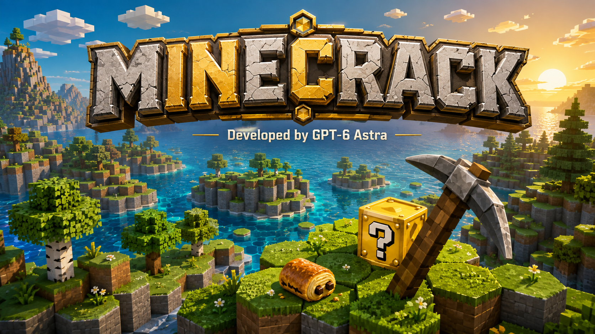

# Minecrack



**Developed by GPT-6 Astra** · Jeu de survie solo · Windows portable · JavaScript / Three.js

Un jeu de survie 3D à la première personne, dans un archipel de blocs hexagonaux : explorez, creusez, construisez et découvrez les 16 surprises des Lucky Blocks.

[**Télécharger pour Windows**](https://github.com/anisayari/minecrack/releases/latest) · [Guide de jeu](docs/GAMEPLAY.md) · [Signaler un problème](https://github.com/anisayari/minecrack/issues)

*La bannière est une illustration promotionnelle générée, pas une capture du jeu. [Prompt et provenance](docs/BANNER.md).*

## Installer et jouer sur Windows

Il faut **Windows 10/11 x64**, un clavier, une souris et **Chrome ou Edge** avec WebGL et accélération graphique. Aucun compte, aucune installation de Node.js et aucune connexion Internet ne sont nécessaires après téléchargement.

1. Ouvrez la [dernière release](https://github.com/anisayari/minecrack/releases/latest).
2. Dans **Assets**, téléchargez **`Minecrack-Windows-v1.3.zip`**. Les archives « Source code » servent au développement ; elles ne contiennent pas le runtime portable.
3. Faites un clic droit sur le ZIP → **Extraire tout**. Gardez tous les fichiers du dossier `Minecrack-Windows-v1.3` ensemble.
4. Ouvrez ce dossier et double-cliquez sur **`Lancer-Minecrack.cmd`**.
5. Une fenêtre de jeu Chrome ou Edge s’ouvre sur [http://127.0.0.1:5194](http://127.0.0.1:5194). Choisissez **Survie** ou **Atelier créatif**, puis cliquez sur **Jouer** pour capturer la souris.

**Gardez la fenêtre du lanceur ouverte pendant la partie.** Pour arrêter le jeu, sauvegardez dans le menu Pause, puis fermez la fenêtre de jeu et le lanceur. Le serveur fonctionne uniquement sur votre ordinateur.

Pour essayer immédiatement la nourriture : dans une nouvelle partie Survie, sélectionnez la chocolatine avec **4**, puis **maintenez le clic droit pendant 1,25 seconde**.

## Installer depuis les sources

Prérequis : **[Node.js 24 LTS](https://nodejs.org/)**, npm (inclus avec Node.js), [Git](https://git-scm.com/) et Chrome ou Edge. La première installation des dépendances nécessite Internet.

```sh
git clone https://github.com/anisayari/minecrack.git
cd minecrack
npm ci
npm run build
npm start -- --open
```

Le dernier appel ouvre le jeu à **http://127.0.0.1:5194**. Si la fenêtre ne s’ouvre pas automatiquement, ouvrez cette adresse dans Chrome ou Edge. Pour les lancements suivants, exécutez seulement `npm start -- --open`. Arrêtez le serveur avec **Ctrl+C** dans le terminal après avoir quitté la partie.

Sous Windows, une fois Node.js installé, **`Lancer-Minecrack.cmd`** à la racine des sources peut aussi préparer puis lancer le jeu automatiquement. Si vous modifiez ou mettez à jour les sources, refaites `npm ci` puis `npm run build` avant de relancer.

Pour modifier le jeu avec rechargement automatique :

```sh
npm run dev
```

Ouvrez **http://127.0.0.1:5194** directement dans Chrome ou Edge. Arrêtez le serveur de production avant de démarrer celui de développement : ils utilisent le même port. Le transfert vers une fenêtre externe est disponible avec `npm start`, pas avec le serveur Vite de développement.

## Souris et navigation

Chrome ou Edge avec WebGL et accélération graphique est recommandé. Cliquez sur **Jouer** ou **Reprendre l’aventure** pour capturer la souris : elle reste dans le jeu et permet de tourner sans limite. **E** ouvre l’inventaire et libère le curseur ; **Échap** ouvre la pause. Si le navigateur intégré refuse la capture, cliquez sur **Ouvrir la fenêtre de jeu** : la partie courante est transférée dans Chrome ou Edge. Le jeu reste arrêté tant que la capture n’a pas réussi.

## En cas de problème

| Symptôme | Solution |
|---|---|
| Le lanceur signale un dossier incomplet | Extrayez tout le ZIP avant de lancer le `.cmd`. Ne lancez pas le jeu depuis l’aperçu de l’archive. |
| « Node.js est requis » | Vous avez téléchargé les sources : installez Node.js 24 LTS ou utilisez le ZIP portable dans Releases. |
| Le port 5194 est déjà utilisé | Fermez le lanceur d’une ancienne partie avant d’en ouvrir un autre. |
| La souris sort de la fenêtre ou n’est pas capturée | Jouez dans Chrome/Edge et cliquez sur **Jouer/Reprendre**. Si proposé, utilisez **Ouvrir la fenêtre de jeu**. |
| Écran noir / erreur WebGL | Activez l’accélération graphique dans Chrome/Edge, redémarrez le navigateur et mettez à jour le pilote graphique. |
| Une ancienne version apparaît | Fermez l’ancien lanceur, démarrez le nouveau et rechargez la page depuis le menu du navigateur. En jeu, F5 change la caméra. |
| Ma sauvegarde semble absente | Utilisez le même navigateur et exactement `http://127.0.0.1:5194`, sans navigation privée ; voir [Monde et sauvegarde](#monde-et-sauvegarde). |

## Version 1.3 — capture FPS et commandes Minecraft

Les déplacements suivent les positions physiques des touches : **ZQSD sur AZERTY, WASD sur QWERTY**. **Ctrl** fait courir ; **Maj** accroupit, ralentit et protège du bord des blocs. **E** et **Échap** ferment l’inventaire et reprennent le jeu. Le clic droit utilise l’objet ; le clic gauche mine ou frappe. **F5** alterne FPS, dos et face ; **F1** masque l’interface ; **F2** capture la vue 3D en PNG. **A sur AZERTY / Q sur QWERTY** jette une unité, avec Ctrl pour toute la pile. Le clic molette sélectionne le bloc visé s’il est disponible, ou le donne en créatif.

Le transfert conserve le terrain et l’inventaire. L’éventuelle sauvegarde déjà présente dans le navigateur d’arrivée est gardée dans une copie locale `minecrack-save-v1-before-transfer`. Le transfert circule uniquement sur le serveur local, expire après deux minutes et ne peut être récupéré qu’une fois. Les commandes de référence sont décrites dans le [guide officiel Minecraft](https://www.minecraft.net/en-us/article/minecraft-controls).

## Version 1.2 — contrôles et interactions de survie

Sélectionnez la chocolatine avec **4** dans une nouvelle partie Survie, puis **maintenez le clic droit pendant 1,25 seconde**. La main porte la nourriture à la bouche, les bouchées émettent un son et des miettes, et une jauge indique l’avancement. Le soin et la consommation d’une unité interviennent à la fin. Relâcher, changer d’objet ou ouvrir un menu annule l’action sans dépenser de nourriture. Le ticket CB12 se consomme en 1,6 seconde ; la réduction d’impôts s’active après 0,9 seconde de lecture.

Manger ralentit la marche et empêche de miner en même temps. Avec 30 points de faim ou moins, le sprint est indisponible. Le clic droit maintenu répète la pose des blocs ; les emplacements occupés par le joueur ou une entité sont protégés. Les objets posables et les invocations vérifient le sol et la place disponible. Une radio, un gnome ou une centrale dont le support disparaît devient un objet à ramasser.

## Version 1.1 — rendu voxel et animations

Les textures de blocs restent en 512 × 512 avec un dessin pixel art à 32 × 32 et un filtrage sans lissage. Les faces sont nettes, le ciel dégradé, les nuages à dessous bleuté et les ombres de contact renforcent les reliefs. Herbes et fleurs bougent légèrement; les couronnes des chênes, bouleaux et sapins sont différenciées.

La pioche enchaîne de vrais coups pendant le clic maintenu. Dix étapes de fissures apparaissent sur le bloc visé; des éclats partent au contact et les débris retombent au sol. Manger, lancer, lire et utiliser un objet ont des mouvements distincts. Les PNJ marchent, frappent au contact du bras, reculent et chutent à leur mort. La radio pulse, le gnome salue et le B2 s’incline en vol.

L’ancienne sauvegarde reste lisible. Les modifications du terrain et l’inventaire sont préservés; les couronnes naturelles sont régénérées selon le nouveau dessin des arbres. Fermez le lanceur de la version précédente avant d’ouvrir cette version.

## Commandes

| Action | Commande |
|---|---|
| Se déplacer | ZQSD ou WASD |
| Regarder | Souris |
| Sauter / remonter dans l’eau | Espace |
| Courir | Ctrl + avancer |
| S’accroupir / rester au bord | Majuscule |
| Miner / attaquer | Clic gauche ; maintenir pour miner |
| Utiliser / poser | Clic droit ; maintenir pour manger, lire le bonus ou construire à la suite |
| Choisir un emplacement | 1 à 9, ou molette |
| Inventaire, objets, artisanat | E |
| Pause / reprendre | Échap |
| Jeter une unité / toute la pile | A sur AZERTY, Q sur QWERTY ; Ctrl pour la pile |
| Sélectionner le bloc visé | Clic molette |
| Changer de perspective | F5 |
| Informations techniques | F3 |
| Masquer l’interface | F1 |
| Capturer la vue 3D en PNG | F2 |

Le mode **Survie** gère vie, faim, respiration, chutes, ressources et agents hostiles. Le mode **Atelier créatif** donne accès aux 16 objets et aux blocs, avec invulnérabilité et utilisation sans consommation des objets. Ouvrez **E** pour affecter un objet à la barre rapide. **F5** montre le personnage et son costume complet, puis revient en vue FPS après les deux vues extérieures.

Le [guide de jeu](docs/GAMEPLAY.md) décrit les 16 effets, les recettes et la progression.

## Monde et sauvegarde

Le monde est **fini et solo** : 3 571 colonnes hexagonales dans le rayon initial de 34 cases, avec plusieurs hauteurs, eau, minerais, chênes, bouleaux et conifères. Une graine reproduit le même terrain initial. Le nombre de Lucky Blocks naturels est exactement `floor(nombre de colonnes terrestres × 0,01)` ; ils apparaissent au-dessus du sol. La graine `MINECRACK` produit 25 Lucky Blocks pour 2 585 colonnes terrestres.

La sauvegarde automatique intervient toutes les 30 secondes de jeu, lors d’un retour au menu et à la fermeture de l’onglet. Le menu Pause propose aussi **Sauvegarder**. Les modifications de blocs, l’inventaire, la position, les effets actifs, les découvertes et les entités persistantes sont conservés dans le stockage local du navigateur. Les projectiles en vol et les passages de bombardiers sont transitoires.

Utilisez le même navigateur et l’adresse **http://127.0.0.1:5194** pour retrouver la partie. Changer de navigateur, de port ou passer à `localhost` crée un espace de sauvegarde distinct. Effacer les données du site supprime la sauvegarde ; déplacer le dossier portable ne transfère pas ces données. Le fichier audio personnel de la radio doit être sélectionné de nouveau après rechargement.

La musique originale de Portal n’est pas fournie. La radio joue une boucle originale ; importez votre fichier audio depuis le menu Pause pour lui faire jouer votre musique. Les [sources des visuels](docs/ASSET-SOURCES.md) et les [licences tierces](docs/THIRD-PARTY.md) précisent ce qui est intégré.

## Développement

JavaScript ESM, Three.js pour le rendu WebGL, Vite pour le build, Web Audio pour le son et Node.js pour le petit serveur HTTP local. Les modèles sont des géométries 3D propres aux objets ; les textures d’objets et de terrain sont en 512 × 512.

```powershell
npm test
npm run build
```

Les **79 tests unitaires** et **18 tests navigateur** ont été validés pour la version 1.3. Pour les tests navigateur, installez Chrome et lancez d’abord `npm start` dans un terminal ; dans un second terminal, exécutez `npm run test:browser`. Les tests utilisent un profil navigateur isolé. `MINECRACK_TEST_URL` permet de cibler un autre serveur local.

| Fichier | Responsabilité |
|---|---|
| `src/main.js` | Boucle de jeu, contrôles, interactions, effets des objets, sauvegarde |
| `src/world.js` | Génération déterministe, blocs, coordonnées axiales, raycasts, journal des modifications |
| `src/terrain-textures.js` | Textures de terrain 512 × 512 calculées au chargement |
| `src/viewmodel.js`, `src/animation-rig.js` | Gestes FPS et squelettes articulés |
| `src/mining-overlay.js` | Dix stades de fissures sur les prismes hexagonaux |
| `src/presentation.js` | Ciel, ombres de contact et rendu final |
| `src/player.js` | Déplacements, collisions, saut, nage et caméra FPS |
| `src/mouse-look.js`, `src/item-use.js` | Souris directe et consommation maintenue avec annulation |
| `src/entities.js` | PNJ, recherche de chemin, objets posés, projectiles, explosions |
| `src/items.js` | Catalogue des 16 objets et modèles 3D |
| `src/inventory.js` | Ressources, barre rapide et recettes |
| `src/audio.js`, `src/effects.js` | Sons synthétisés, radio et effets visuels |
| `src/ui.js`, `src/style.css` | Menus, inventaire et interface de jeu |
| `scripts/serve.mjs`, `scripts/desktop-launch.mjs` | Serveur local, ouverture de la fenêtre de jeu et transfert de partie |

`HexWorld` expose `generate()`, `getBlock()`, `setBlock()`, `removeBlock()`, `rebuild()`, `raycast()`, `serialize()` et `restore()`. Les coordonnées `(q,r)` désignent une colonne hexagonale ; `y` est le bas du bloc. `surfaceY()` renvoie l’indice du bloc solide supérieur, `getGroundHeight()` son sommet ; une colonne sans sol renvoie `-Infinity`. Appelez `rebuild()` après un lot de modifications. La sauvegarde du monde contient la graine et les modifications ; elle s’applique après régénération avec cette graine.

Les tests Node vérifient notamment la géométrie hexagonale, les Lucky Blocks, la restauration, les raycasts, les collisions du joueur, la limite du monde, les recettes, les modèles et les réactions en chaîne.

Pour préparer la distribution Windows, après validation du build :

```powershell
npm run build
node scripts/package.mjs
Compress-Archive -Path release\Minecrack-Windows-v1.3 -DestinationPath release\Minecrack-Windows-v1.3.zip -Force
```

Le script de packaging nécessite le runtime **Node.js v24.18.0 Windows x64** et les dépendances locales. Il recrée uniquement `release/Minecrack-Windows-v1.3`, y copie le build, les deux modules du serveur, le runtime et les licences, sans installation ni téléchargement. La vérification des licences se fait depuis les copies locales.

## Crédits et ressources

**Developed by GPT-6 Astra**, à la demande d’Anis Ayari. Moteur de rendu : Three.js. La bannière du README a été produite avec l’outil de génération d’images intégré ; son [prompt est conservé](docs/BANNER.md).

Les modèles et sons synthétisés ont été créés pour Minecrack. Les images et logos tiers conservent les droits de leurs titulaires : consultez les [sources des assets](docs/ASSET-SOURCES.md) et les [licences des composants](docs/THIRD-PARTY.md). La publication de ce dépôt ne place pas ces éléments sous une licence libre. Minecrack est un projet indépendant, sans affiliation officielle avec Minecraft ou les marques et personnalités référencées.
